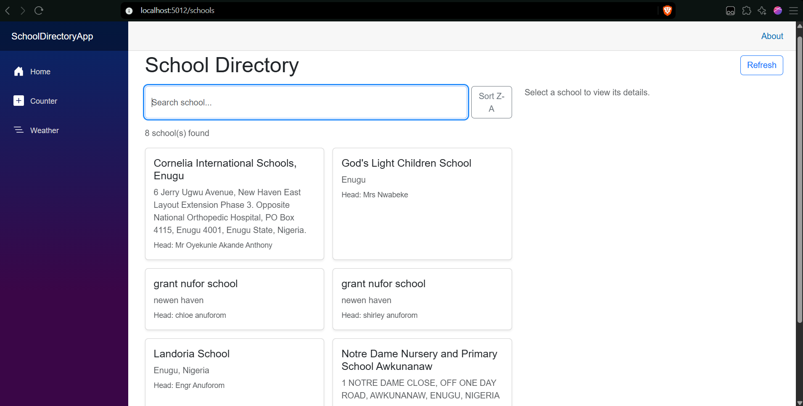
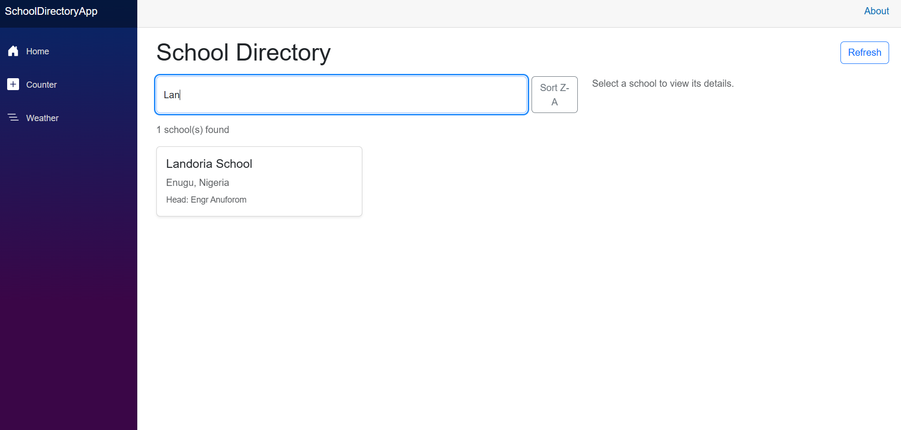
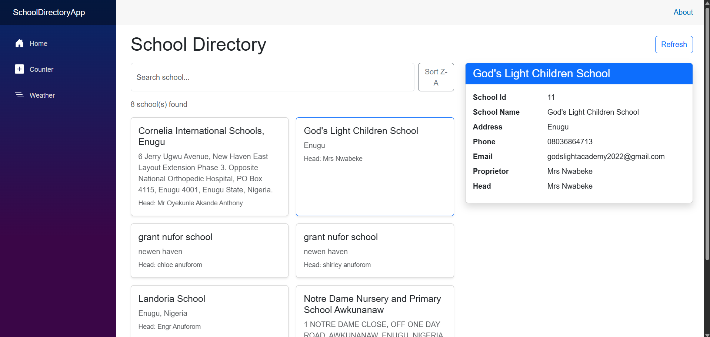
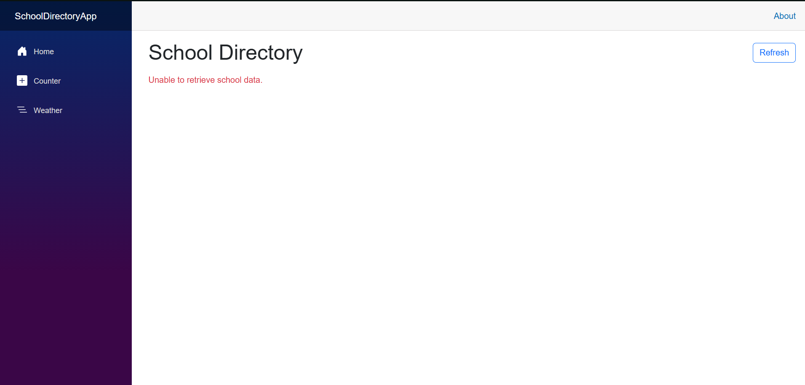
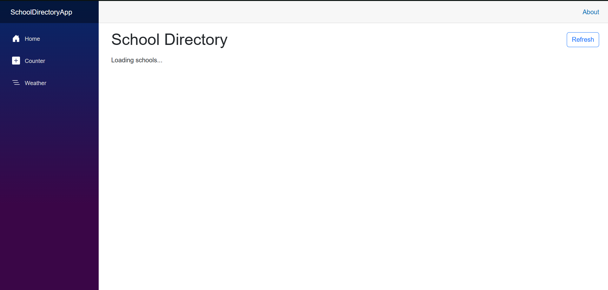
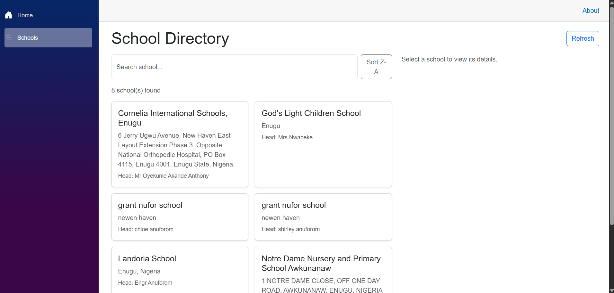

# School Directory Dashboard

## Project Description
A Blazor web application that consumes the Edutots School API and displays
school information in a clean, interactive interface. Users can browse all
schools, search by name, sort the list, and select a school to view its
detailed information.

## Features
- Retrieves school data from the Edutots School API using `HttpClient`
- Deserializes JSON responses into C# models
- Search schools by name (live filtering with `@bind:event="oninput"`)
- Reusable `SchoolCard` component using `[Parameter]` and `EventCallback<School>`
- `SchoolDetails` component showing the selected school's information
- Loading state while data is being retrieved
- Error handling when the API request fails
- Sorting (A-Z / Z-A) and a Refresh button
- Responsive Bootstrap layout
- Removed the default template pages (Counter, Weather) and added a Schools menu link

## Technologies Used
- C#
- .NET 8
- Blazor Web App (Interactive Server)
- HttpClient
- Bootstrap 5
- Git and GitHub

## API Endpoint
```
GET https://edutots.net/api/school
```

## Project Structure
```
SchoolDirectoryApp
├── Models
│   └── School.cs
├── Services
│   └── SchoolService.cs
├── Components
│   ├── SchoolCard.razor
│   ├── SchoolDetails.razor
│   └── Pages
│       └── Schools.razor
└── Program.cs
```

## How to Run the Application
1. Install the [.NET 8 SDK](https://dotnet.microsoft.com/download).
2. Clone the repository:
```bash
   git clone https://github.com/Jasim2032/SchoolDirectoryApp
```
3. Go into the project folder:
```bash
   cd SchoolDirectoryApp
```
4. Run the application:
```bash
   dotnet run
```
5. Open the address shown in the terminal and go to `/schools`,
   for example `http://localhost:5012/schools`.

An internet connection is required because the app calls the live API.

## Screenshots

### 1. School list loaded successfully


### 2. Search functionality


### 3. School details view


### 4. Loading state


### 5. Error state


### 6. Cleaned-up navigation (sample pages removed)
